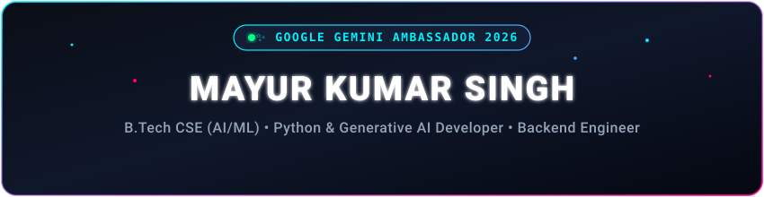

<div align="center">
  <!-- Custom High-Performance Animated Header -->
  

  <br/><br/>

  <!-- Custom Animated Cyber Status HUD -->
  

  <br/><br/>

  <!-- Dynamic Animated Typewriter -->
  <a href="https://github.com/mayursingh24">
    
  </a>

  <br/><br/>

  <!-- Social Badges & Live Profile Views -->
  <p align="center">
    <a href="https://linkedin.com/in/Mayursingh24" target="_blank">
      
    </a>
    &nbsp;
    <a href="mailto:mayur4singhhh@gmail.com" target="_blank">
      
    </a>
    &nbsp;
    <a href="https://instagram.com/_mayur.x24" target="_blank">
      
    </a>
    &nbsp;
    
  </p>
</div>

<p align="center">
  
</p>

### 👨‍💻 About Me

```yaml
Developer: Mayur Kumar Singh
Education: B.Tech in CSE (Specialization in AI & ML)
Recognition: Google Gemini Student Ambassador 2026 ✨
Location: Lucknow, Uttar Pradesh, India 📍
Core Expertise: Generative AI, Computer Vision (OCR), Python Backend Architecture
Status: Open to AI/ML Internships & Technical Collaborations 🚀
```

- 🎓 **B.Tech CSE (AI/ML)**: Strong grounding in data structures, algorithms, machine learning workflows, and intelligent software engineering.
- 🤖 **Generative AI & LLM Engineering**: Practical experience building production workflows using **Google Gemini API**, **Grok API**, document OCR, and multimodal prompt architectures.
- ⚙️ **Backend & Database Systems**: Designing scalable RESTful APIs, relational databases, and clean architecture with **Python**, **Flask**, **Django**, and **MySQL**.
- 🏆 **Hackathons & Competitions**:
  - 🌟 **Google Gemini Student Ambassador 2026**
  - 🏅 **Top Qualifier (Internal Round)** — Smart India Hackathon
  - 🥉 **3rd Position** — Flowzint AI Hackathon
- 💼 **Looking For**: Opportunities to contribute to challenging AI/ML and full-stack software products.

<p align="center">
  
</p>

### 🛠️ Tech Stack & Tooling

<div align="center">

#### 💻 Languages, Frameworks & Infrastructure
<p align="center">
  <a href="https://skillicons.dev">
    
  </a>
</p>

#### 🧠 AI, ML & API Integration
<p align="center">
  
  &nbsp;
  
  &nbsp;
  
  &nbsp;
  
  &nbsp;
  
</p>

</div>

<p align="center">
  
</p>

### 🚀 Featured Projects

| Project | Overview | Core Technologies |
| :--- | :--- | :--- |
| 🩺 **Medilens AI** | Intelligent prescription processing assistant utilizing OCR + Generative AI to decipher handwritten prescriptions and extract accurate medicine details. | `Python` `Flask` `MySQL` `OCR` `Gemini API` `Grok API` |
| 📚 **NoteLense** | Multimodal document analysis platform parsing PDFs, DOCX, and images to generate structured notes, quizzes, MCQs, and custom study itineraries. | `Python` `Flask` `OCR` `Gemini API` |
| 🏪 **MyDukaan24** | Comprehensive SMB retail management software handling inventory control, customer credit (udhaar) accounting, invoice generation, and sales metrics. | `Python` `Flask` `MySQL` `Android` |
| 🛡️ **SENTINEL-AI** | Hackathon intelligence solution engineered for relationship node analysis and pattern recognition across complex criminal network data. | `Python` `Flask` `MySQL` `Gemini API` |

<p align="center">
  
</p>

### 📊 GitHub Activity & Real-Time Metrics

<div align="center">

<table border="0">
  <tr>
    <td align="center" valign="middle">
      
    </td>
    <td align="center" valign="middle">
      
    </td>
  </tr>
  <tr>
    <td colspan="2" align="center" valign="middle">
      <br/>
      
    </td>
  </tr>
</table>

</div>

<p align="center">
  
</p>

<div align="center">
  <!-- Custom High-Performance Animated Footer -->
  
</div>
